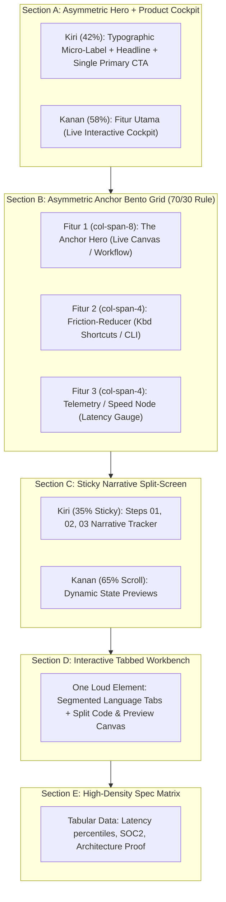

# Section Layout Choreography & Feature Placement Blueprint (Anti-Card-Slop Manual)

Dokumen ini adalah standar arsitektur tata letak antarmuka bagi AI Agent agar tidak lagi menghasilkan layout generik. Di dunia nyata, desainer Staff/Principal tidak pernah menaruh 3 kartu identik di setiap section. Mereka membangun **ritme naratif (narrative rhythm)**, **kontras bobot visual (visual mass)**, dan **penempatan fitur yang beralasan (deliberate feature placement)**.

---

## 1. Penyakit Utama: Mengapa Layout AI Slop Terlihat Amatir?

1. **Sindrom 3 Kartu Identik (`grid-cols-3` Slop)**:
   Setiap section dibuat dengan `grid grid-cols-1 md:grid-cols-3 gap-6`. Setiap kartu memiliki icon berwarna di dalam lingkaran, judul `h3`, dan 3 baris deskripsi. Hasilnya: membosankan, tidak berjiwa, dan tidak ada hierarki.
2. **Tidak Ada "Anchor Feature"**:
   Semua fitur dianggap memiliki nilai yang sama. Pengguna tidak tahu mana fitur pahlawan (hero feature) dan mana fitur pendukung minor.
3. **Ketiadaan Real Product Software**:
   Card hanya diisi teks promosi abstrak (*"Boost your productivity with AI-driven insights"*), bukan komponen antarmuka perangkat lunak riil (DOM asli seperti query builder, code snippet interaktif, atau telemetri).
4. **Hero Simetris yang Pasif**:
   Hero section di-tengah (*centered*), teks 4 baris, 2 tombol simetris (*Get Started* dan *Learn More*), lalu ruang kosong di bawah fold.

---

## 2. Hukum Baku: Visual Mass & Narrative Pacing

### A. Prinsip "One Loud Element Per Section, The Rest Quiet"
Dalam satu viewport pandangan pengguna:
- **Hanya boleh ada 1 (satu) elemen visual yang "Loud"** (misal: Live Product Cockpit, interactive playground, atau visual query canvas).
- Elemen-elemen lainnya di section tersebut **harus "Quiet"** (menggunakan tipografi monokrom yang tenang, micro-labels, hairline borders, dan statistik terstruktur).
- *Dua elemen loud yang bertabrakan akan membuat mata pengguna lelah dan antarmuka terasa berisik.*

### B. Ritme Kepadatan (Pacing Rhythm)
Sebuah halaman landing page atau antarmuka aplikasi harus memiliki ritme pernapasan:
- **Section A**: Asymmetric & Cockpit-Dense (Langsung membuktikan software di atas fold).
- **Section B**: Anchor Bento Grid (Kontras antara 1 fitur raksasa 70% dan 2 fitur pendukung 30%).
- **Section C**: Sticky Narrative Split-Screen (Ritme scrolling bertahap yang tenang).
- **Section D**: Deep-Dive Interactive Workbench (1 kanvas kerja penuh untuk hands-on test).
- **Section E**: High-Density Spec & Data Matrix (Kredibilitas teknis berbasis data, bukan testimoni klise).

---

## 3. Blueprint Tata Letak Section & Penempatan Fitur



---

### Section A: The Top-Down Stacked Hero (Pola Clean Software Cockpit)

Hero dapat menggunakan **Top-Down Stacked Layout** (Teks Terpusat di Atas $\rightarrow$ Cockpit Visual Terpusat di Bawah) atau **Asymmetric Split Layout**. Dalam irama selang-seling (zig-zag):

1. **Section 1 (Hero)**: Top-Down Stacked (Teks Terpusat Top $\rightarrow$ Cockpit Visual Bottom).
2. **Section 2**: Left (Ilustrasi / 70% Anchor Card) $\rightarrow$ Right (Teks Header & Secondary Stacked Cards).
3. **Section 3**: Left (Teks Header & Tabs) $\rightarrow$ Right (Ilustrasi Interactive Workbench).
4. **Section 4**: Left (Ilustrasi Visual Security Gauge) $\rightarrow$ Right (Teks Header & Specs Ledger Table).

```tsx
// Pattern Section A: Top-Down Stacked Hero Cockpit
export function SectionHeroStacked() {
  return (
    <section className="min-h-screen flex flex-col justify-center relative pt-24 pb-16 lg:py-0 overflow-hidden border-b border-border/40">
      <div className="mx-auto max-w-7xl px-4 sm:px-6 lg:px-8 relative z-10 w-full flex flex-col items-center">
        
        {/* Top Centered Header Content */}
        <div className="max-w-3xl mx-auto text-center flex flex-col items-center space-y-6">
          <h1 className="text-4xl sm:text-5xl lg:text-6xl font-bold tracking-tight text-foreground leading-[1.08]">
            Autonomous AI agents built for software development.
          </h1>
          <p className="text-base text-muted-foreground max-w-2xl leading-relaxed font-sans text-center">
            State-deterministic infrastructure and live workflow orchestration for high-velocity software teams.
          </p>
          <div className="flex items-center justify-center gap-3.5 pt-2">
            <button className="rounded-lg hover:rounded-full bg-primary px-6 py-3 text-sm font-semibold text-primary-foreground transition-all duration-300 ease-out">
              Get Started
            </button>
          </div>
        </div>

        {/* Bottom Centered Cockpit Visual */}
        <div className="max-w-4xl mx-auto mt-10 w-full">
          <div className="rounded-xl border border-border/60 bg-card p-6 shadow-2xl">
            {/* Focused visual cockpit */}
          </div>
        </div>

      </div>
    </section>
  );
}
      <div className="mx-auto w-full max-w-7xl grid grid-cols-1 lg:grid-cols-12 gap-12 lg:gap-8 items-center">
        
        {/* Kolom Kiri: 42% Visual Space (col-span-5) */}
        <div className="lg:col-span-5 flex flex-col items-start gap-6">
          {/* Confident Category Eyebrow (Human Sans-Serif, no robotic // slop) */}
          <span className="text-xs font-semibold text-primary">
            Engineering Workflow
          </span>

          <h1 className="text-4xl sm:text-5xl lg:text-6xl font-semibold tracking-[-0.035em] text-foreground leading-[1.08]">
            Issue tracking that keeps pace with your thoughts.
          </h1>

          <p className="text-base sm:text-lg text-muted-foreground leading-relaxed max-w-lg">
            Purpose-built for high-velocity software teams. Zero friction, sub-50ms interactions, and real-time multiplayer sync.
          </p>

          <div className="flex flex-col sm:flex-row items-stretch sm:items-center gap-3 w-full sm:w-auto pt-2">
            <button className="h-10 px-5 rounded-lg bg-foreground text-background font-medium text-sm transition-all hover:opacity-90 active:scale-[0.98]">
              Start building free
            </button>
            <div className="flex items-center gap-2 px-3 py-2 rounded-lg border border-border/60 bg-muted/20 font-mono text-xs text-muted-foreground">
              <span className="text-foreground">$</span>
              <span>npm i @workflow/core</span>
            </div>
          </div>
        </div>

        {/* Kolom Kanan: 58% Visual Space (col-span-7) -> LIVE SOFTWARE COCKPIT */}
        <div className="lg:col-span-7 w-full">
          <div className="relative rounded-xl border border-border/80 bg-card/60 shadow-2xl backdrop-blur-sm overflow-hidden">
            {/* Header Jendela Software Mini */}
            <div className="h-9 border-b border-border/60 bg-muted/40 px-4 flex items-center justify-between">
              <div className="flex items-center gap-1.5">
                <div className="size-2.5 rounded-full bg-border" />
                <div className="size-2.5 rounded-full bg-border" />
                <div className="size-2.5 rounded-full bg-border" />
              </div>
              <span className="text-xs font-medium text-muted-foreground">active_session.live</span>
              <div className="size-2 rounded-full bg-emerald-500" />
            </div>

            {/* Live Interactive Cockpit: Kanban/Timeline/Editor Asli */}
            <div className="p-5 font-mono text-xs space-y-3">
              <div className="flex items-center justify-between pb-3 border-b border-border/40">
                <span className="text-muted-foreground font-sans text-xs">Workspace: Acme Infra</span>
                <span className="text-emerald-400">SYNCED 4ms AGO</span>
              </div>
              {/* Cockpit items... */}
            </div>
          </div>
        </div>

      </div>
    </section>
  );
}
```

---

### Section B: The Asymmetric Anchor Bento Grid (Aturan 70/30)

Ini adalah solusi definitif untuk menempatkan **Fitur 1, Fitur 2, dan Fitur 3** tanpa menjadi 3 kartu identik yang membosankan.

- **Fitur 1 ("The Anchor Hero", `col-span-8`)**:
  - Mengambil 65-70% lebar grid.
  - Memuat fitur yang menjadi daya jual utama (misal: live SQL query canvas, timeline reaktif, atau visual pipeline editor).
  - Terdapat micro-interaksi atau demonstrasi visual aktif.
- **Fitur 2 ("The Friction-Reducer", `col-span-4`)**:
  - Mengambil 30-35% lebar kolom atas.
  - Menunjukkan betapa mudah dan cepatnya developer menggunakannya (misal: keyboard navigation shortcuts dengan `<kbd>`, instantaneous fuzzy search preview).
- **Fitur 3 ("The Telemetry / Performance Node", `col-span-4`)**:
  - Mengambil 30-35% lebar kolom bawah.
  - Membuktikan angka performa (misal: micro latency gauge `<38ms`, edge cache distribution mini bar, zero-downtime indicator).

```tsx
// Pattern Section B: Asymmetric Anchor Bento (70/30 Rule)
export function SectionAnchorBento() {
  return (
    <section className="py-24 px-6 lg:px-12 max-w-7xl mx-auto">
      {/* Section Header yang tenang */}
      <div className="max-w-2xl mb-12">
        <span className="text-xs font-semibold text-primary">
          Core Capabilities
        </span>
        <h2 className="text-3xl font-semibold tracking-[-0.03em] text-foreground mt-2">
          Engineered for deterministic speed.
        </h2>
      </div>

      {/* 12-Column Asymmetric Bento Grid */}
      <div className="grid grid-cols-1 lg:grid-cols-12 gap-4">
        
        {/* FITUR 1: THE ANCHOR HERO (col-span-8, min-h-[420px]) */}
        <div className="lg:col-span-8 rounded-xl border border-border/80 bg-card p-6 flex flex-col justify-between relative overflow-hidden group">
          <div className="max-w-md z-10">
            <span className="text-xs font-medium text-muted-foreground">State Orchestration</span>
            <h3 className="text-xl font-medium tracking-tight text-foreground mt-1">
              Visual State Synchronization
            </h3>
            <p className="text-sm text-muted-foreground mt-2">
              Inspect real-time state mutations across distributed clients. Every state delta is cryptographically verified in memory.
            </p>
          </div>

          {/* Canvas Visual Nyata (Loud Element) */}
          <div className="mt-8 rounded-lg border border-border/60 bg-muted/20 p-4 font-mono text-xs">
            {/* Diagram node, query simulator, atau live canvas */}
            <div className="flex items-center justify-between text-muted-foreground border-b border-border/40 pb-2">
              <span>ROOT_GRAPH</span>
              <span className="text-primary font-medium">RECONCILED</span>
            </div>
            <div className="pt-3 space-y-1.5 text-foreground/80">
              <p>→ dispatch(&apos;node_mutation&apos;, &#123; latency: 12ms &#125;)</p>
              <p className="text-muted-foreground">  ↳ snapshot diff calculated in 1.4ms</p>
            </div>
          </div>
        </div>

        {/* Kolom Samping (col-span-4): Fitur 2 & Fitur 3 yang Stacked */}
        <div className="lg:col-span-4 flex flex-col gap-4">
          
          {/* FITUR 2: THE FRICTION-REDUCER (col-span-12 / col-span-4) */}
          <div className="flex-1 rounded-xl border border-border/80 bg-card p-6 flex flex-col justify-between">
            <div>
              <span className="text-xs font-medium text-muted-foreground">Instant Velocity</span>
              <h3 className="text-base font-medium tracking-tight text-foreground mt-1">
                Zero-Context Switching
              </h3>
              <p className="text-xs text-muted-foreground mt-1.5">
                Every action accessible in under 3 keystrokes.
              </p>
            </div>

            {/* Monospace UI Shortcut Snippet */}
            <div className="mt-4 pt-4 border-t border-border/40 space-y-2">
              <div className="flex items-center justify-between text-xs font-mono">
                <span className="text-muted-foreground">Quick Switcher</span>
                <kbd className="px-1.5 py-0.5 rounded border border-border bg-muted/60 text-[10px]">⌘K</kbd>
              </div>
              <div className="flex items-center justify-between text-xs font-mono">
                <span className="text-muted-foreground">Cycle Status</span>
                <kbd className="px-1.5 py-0.5 rounded border border-border bg-muted/60 text-[10px]">S</kbd>
              </div>
            </div>
          </div>

          {/* FITUR 3: THE TELEMETRY NODE (col-span-12 / col-span-4) */}
          <div className="flex-1 rounded-xl border border-border/80 bg-card p-6 flex flex-col justify-between">
            <div>
              <span className="text-xs font-medium text-muted-foreground">Real-time Telemetry</span>
              <h3 className="text-base font-medium tracking-tight text-foreground mt-1">
                Sub-Millisecond Engine
              </h3>
              <p className="text-xs text-muted-foreground mt-1.5">
                Edge-replicated across 35 global regions.
              </p>
            </div>

            {/* Micro Latency Gauge */}
            <div className="mt-4 pt-4 border-t border-border/40">
              <div className="flex items-baseline justify-between">
                <span className="text-2xl font-mono font-semibold text-foreground tracking-tight">&lt; 38ms</span>
                <span className="text-[11px] font-mono text-emerald-500">P99 GLOBAL</span>
              </div>
              <div className="w-full bg-muted/40 h-1.5 rounded-full mt-2 overflow-hidden">
                <div className="bg-primary h-full rounded-full w-[88%]" />
              </div>
            </div>
          </div>

        </div>

      </div>
    </section>
  );
}
```

---

### Section C: The Sticky Narrative Split-Screen (Pola Multi-Tahap Stripe / Anthropic)

Ketika menjelaskan alur kerja produk bertahap (misal: Step 1: Connect Schema -> Step 2: Auto-Generate Edge APIs -> Step 3: Global Rollout):

- **Sisi Kiri (35-40%, Sticky)**: Menempel di viewport (`sticky top-28 self-start`).
  - Berisi judul section besar, status tracker progres, dan narasi yang membimbing alur berpikir pembaca.
- **Sisi Kanan (60-65%, Scrolling Stream)**:
  - Berisi tumpukan 3 preview panel interaktif berbeda ukuran yang bergulir alami.
  - Setiap panel merepresentasikan software state yang riil, bukan screenshot buram.

```tsx
// Pattern Section C: Sticky Narrative Split-Screen
export function SectionStickySplitNarrative() {
  const steps = [
    {
      num: "01",
      title: "Define your domain schema",
      desc: "Write native TypeScript interfaces. Types are inferred with zero codegen overhead.",
      snippet: `interface Order {\n  id: UUID;\n  amount: CentAmount;\n  status: 'settled' | 'pending';\n}`
    },
    {
      num: "02",
      title: "Deploy globally to the edge",
      desc: "Instances replicate within 150ms across Frankfurt, Tokyo, and Virginia.",
      snippet: `edge.deploy({\n  regions: ['fra', 'hnd', 'iad'],\n  failover: 'deterministic'\n});`
    },
    {
      num: "03",
      title: "Stream telemetry in real-time",
      desc: "Sub-microsecond trace propagation directly to your OpenTelemetry dashboard.",
      snippet: `telemetry.subscribe((event) => {\n  metrics.p99.record(event.latencyMs);\n});`
    }
  ];

  return (
    <section className="py-24 px-6 lg:px-12 max-w-7xl mx-auto border-t border-border/50">
      <div className="grid grid-cols-1 lg:grid-cols-12 gap-12 lg:gap-16">
        
        {/* SISI KIRI: STICKY NARRATIVE COLUMN (col-span-5) */}
        <div className="lg:col-span-5 lg:sticky lg:top-28 lg:self-start space-y-6">
          <span className="text-xs font-semibold text-primary">
            Architecture Pipeline
          </span>
          <h2 className="text-3xl sm:text-4xl font-semibold tracking-[-0.03em] text-foreground leading-tight">
            From typed definition to planetary edge in seconds.
          </h2>
          <p className="text-muted-foreground text-sm sm:text-base leading-relaxed">
            Eliminate traditional database migrations, RPC boilerplate, and fragile schema syncing. Three deterministic phases run in harmony.
          </p>
        </div>

        {/* SISI KANAN: SCROLLING CARD STREAM (col-span-7) */}
        <div className="lg:col-span-7 space-y-8">
          {steps.map((step) => (
            <div key={step.num} className="rounded-xl border border-border/80 bg-card p-6 sm:p-8 space-y-4 shadow-sm">
              <div className="flex items-center justify-between">
                <span className="font-sans text-xs font-bold text-primary">{step.num}</span>
                <span className="text-xs text-muted-foreground font-sans">Active Runtime</span>
              </div>
              <h3 className="text-xl font-medium tracking-tight text-foreground">{step.title}</h3>
              <p className="text-sm text-muted-foreground leading-relaxed">{step.desc}</p>
              
              {/* Monospace Code Preview Box */}
              <div className="rounded-lg border border-border/50 bg-muted/30 p-4 font-mono text-xs text-foreground/90 overflow-x-auto">
                <pre>{step.snippet}</pre>
              </div>
            </div>
          ))}
        </div>

      </div>
    </section>
  );
}
```

---

### Section D: Deep-Dive Interactive Workbench / Tabbed Playground (Pola Vercel / Resend)

Pola ini menempatkan **satu kanvas kerja penuh ("One Loud Element")** yang membuktikan perangkat lunak bisa langsung dicoba oleh pengguna tanpa perlu mendaftar terlebih dahulu.

- Di atas: Segmented tab switch (`cURL`, `TypeScript`, `Python`, `Go`).
- Di dalam: Editor di kiri (45%), live render output atau payload JSON di kanan (55%).

---

### Section E: High-Density Spec & Proof Matrix (Pola Ramp / Mercury)

**Haram**: Memasang ulasan bintang 5 palsu berputar (*"This AI changed my life!" - John Doe*).
**Ganti dengan**: High-density engineering ledger:
- Monospace key-value table (misal: TLS 1.3, SOC2 Type II Certified, End-to-end encrypted with Argon2id, P99 Replication < 45ms).
- Memancarkan aura kredibilitas institusional kelas dunia.

---

## 4. Decision Tree: Ke Mana Fitur X Harus Ditempatkan?

Saat kamu merancang halaman baru dengan daftar fitur dari user:

```
[DAFTAR FITUR DARI USER]
       │
       ├─► Apakah ini Core Value Proposition / Fitur Utama Paling Wow?
       │     └─► JANGAN ditaruh di card biasa!
       │     └─► Jadikan LIVE COCKPIT di Section A (Hero Kanan), atau
       │     └─► Jadikan ANCHOR CARD 70% di Section B.
       │
       ├─► Apakah ini fitur Developer Experience (Keyboard shortcuts, CLI, Fast Switch)?
       │     └─► Taruh di Section B (Fitur 2: Friction-Reducer) dengan badge <kbd> & mono font.
       │
       ├─► Apakah ini angka kecepatan / SLA / Latency / Uptime?
       │     └─► Taruh di Section B (Fitur 3: Telemetry Node) atau Section E (Spec Matrix).
       │
       ├─► Apakah ini alur kerja multi-tahap (1 -> 2 -> 3)?
       │     └─► Susun ke dalam Section C (Sticky Narrative Split-Screen).
       │
       └─► Apakah ini API / SDK / Code playground?
             └─► Jadikan Section D (Interactive Workbench dengan tab switcher).
```

---

## 5. Protokol Degradasi Responsif Mobile (`< 768px`)

1. **Section A (Hero)**:
   - Kolom teks di atas, lalu Cockpit meluncur ke bawahnya secara alami dengan border yang rapi. Jangan sembunyikan Cockpit; perkecil ukuran teksnya menjadi `text-[11px]` agar tetap muat tanpa horizontal scroll.
2. **Section B (Anchor Bento)**:
   - Bento berubah dari `grid-cols-12` menjadi `grid-cols-1`.
   - Urutan stack: **Fitur 1 (Anchor)** selalu pertama, diikuti **Fitur 2 (Friction-Reducer)**, lalu **Fitur 3 (Telemetry)**.
3. **Section C (Sticky Split-Screen)**:
   - Nonaktifkan `sticky top` di mobile (`lg:sticky`).
   - Tampilkan judul naratif di atas, lalu tumpuk kartu tahap 01, 02, 03 ke bawah secara linear.

---

## 6. Arsitektur Navbar & Footer Modern (Standar Vercel & Linear)

Navbar dan Footer adalah bingkai penentu kualitas pertama dan terakhir dari sebuah produk. Desain AI amatir sering menaruh tombol theme toggle sembarangan di navbar dan membuat footer seadanya.

### Section F: The Modern Floating Pill Navbar (Unik & Exclusive Benchmark)

Pola **Floating Pill Navbar** memberikan kesan tampilan produk yang unik, melayang, dan terpisah dari gaya navbar full-bleed standar.

```tsx
// Pattern Section F: Modern Floating Pill Navbar (Floating Inset Pill)
export function FloatingPillNavbar({ onOpenSearch }: { onOpenSearch: () => void }) {
  return (
    <header className="fixed top-4 left-1/2 -translate-x-1/2 z-50 w-[calc(100%-2rem)] max-w-5xl rounded-full border border-border/40 bg-background/85 backdrop-blur-xl shadow-2xl shadow-black/40 transition-all">
      <div className="flex h-12 items-center justify-between px-4 sm:px-6">
        
        {/* Sisi Kiri: Brand Logo & Quiet Links */}
        <div className="flex items-center gap-6">
          <a href="/" className="flex items-center gap-2 text-foreground font-semibold text-sm tracking-tight">
            <div className="size-6 rounded-full bg-foreground flex items-center justify-center text-background font-bold text-xs">
              ▲
            </div>
            <span>Platform</span>
          </a>

          <nav className="hidden md:flex items-center gap-1 text-xs font-medium text-muted-foreground">
            <a href="#overview" className="rounded-full px-3 py-1 hover:text-foreground hover:bg-muted/50 transition-colors">
              Overview
            </a>
            <a href="#features" className="rounded-full px-3 py-1 hover:text-foreground hover:bg-muted/50 transition-colors">
              Capabilities
            </a>
            <a href="#workbench" className="rounded-full px-3 py-1 hover:text-foreground hover:bg-muted/50 transition-colors">
              Surfaces
            </a>
            <a href="#specs" className="rounded-full px-3 py-1 hover:text-foreground hover:bg-muted/50 transition-colors">
              Telemetry
            </a>
          </nav>
        </div>

        {/* Sisi Kanan: ⌘K Shortcut Trigger & Action CTA */}
        <div className="flex items-center gap-2.5">
          <button
            onClick={onOpenSearch}
            className="hidden sm:flex items-center gap-2 rounded-full border border-border/60 bg-muted/30 px-3 py-1 text-xs text-muted-foreground hover:border-border hover:text-foreground transition-all"
          >
            <span>Search docs</span>
            <kbd className="rounded border border-border/80 bg-muted/60 px-1.5 py-0.2 font-mono text-[10px]">⌘K</kbd>
          </button>

          <a
            href="#console"
            className="inline-flex h-8 items-center justify-center rounded-full bg-primary px-3.5 text-xs font-medium text-primary-foreground transition-all hover:opacity-90 active:scale-[0.98]"
          >
            Console
          </a>
        </div>

      </div>
    </header>
  );
}
```

---

### Section G: The Modern High-Craft Footer (Vercel / Linear Benchmark & Oversized Wordmark Pattern)

Footer modern masa kini mengombinasikan **grid multi-kolom terstruktur** dengan **Oversized Brand Wordmark** (teks brand raksasa `text-[13vw]` ber-opacity halus `text-foreground/[0.06]`) di bagian penutup. Ini memberikan kesan *editorial closure* yang grounded, berwibawa, dan sangat modern.

> **Aturan Indikator Status**: Gunakan border dan background tint murni (misal `border border-emerald-500/30 bg-emerald-500/10 text-emerald-400`). **Haram** menggunakan dot dekoratif di dalam badge maupun `animate-ping` radar circles.

```tsx
// Pattern Section G: Modern High-Craft Footer with Oversized Wordmark
export function ModernFooter() {
  const footerColumns = [
    {
      title: "Product",
      links: ["Features", "Multiplayer Engine", "Enterprise", "Changelog", "Roadmap"],
    },
    {
      title: "Developers",
      links: ["Documentation", "API Reference", "SDK Libraries", "CLI Tools", "Open Source"],
    },
    {
      title: "Resources",
      links: ["Customer Stories", "Security & Compliance", "System Status", "Community", "Brand Assets"],
    },
    {
      title: "Company",
      links: ["About", "Careers", "Blog", "Privacy Policy", "Terms of Service"],
    },
  ];

  return (
    <footer className="border-t border-border/50 bg-background pt-16 pb-12 px-6 lg:px-12 overflow-hidden">
      <div className="mx-auto max-w-7xl">
        
        {/* Multi-Column Technical Grid */}
        <div className="grid grid-cols-2 md:grid-cols-5 gap-8 lg:gap-12 pb-12 border-b border-border/40">
          
          {/* Kolom 1: Brand & Operational Status Indicator */}
          <div className="col-span-2 md:col-span-1 space-y-4">
            <div className="flex items-center gap-2 font-semibold text-sm tracking-tight text-foreground">
              <div className="size-5 rounded-md bg-foreground flex items-center justify-center text-background font-bold text-xs">
                ▲
              </div>
              <span>Platform</span>
            </div>
            
            <p className="text-xs text-muted-foreground leading-relaxed max-w-xs">
              State-deterministic infrastructure for high-velocity software teams.
            </p>

            {/* Live Operational Status Indicator (Clean Border & Background Tint - NO interior dot slop) */}
            <div className="inline-flex items-center rounded border border-emerald-500/30 bg-emerald-500/10 px-2.5 py-1 text-[11px] text-emerald-400 font-sans font-medium">
              All systems normal
            </div>
          </div>

          {/* Kolom 2-5: Quiet Link Columns */}
          {footerColumns.map((col) => (
            <div key={col.title} className="space-y-3">
              <h4 className="text-xs font-semibold text-foreground tracking-tight">{col.title}</h4>
              <ul className="space-y-2">
                {col.links.map((link) => (
                  <li key={link}>
                    <a href={`#${link.toLowerCase().replace(/\s+/g, "-")}`} className="text-xs text-muted-foreground hover:text-foreground transition-colors">
                      {link}
                    </a>
                  </li>
                ))}
              </ul>
            </div>
          ))}

        </div>

        {/* Oversized Brand Wordmark (Editorial Grounded Closure) */}
        <div className="w-full border-b border-border/30 py-8 sm:py-12 text-center select-none pointer-events-none">
          <span className="block text-[13vw] font-bold tracking-tighter leading-none text-foreground/[0.06] uppercase">
            PLATFORM
          </span>
        </div>

        {/* Bottom Bar: Copyright & Subtle Region Badge */}
        <div className="pt-8 flex flex-col sm:flex-row items-center justify-between gap-4 text-xs text-muted-foreground font-sans">
          <p>© 2026 Platform Systems, Inc. All rights reserved.</p>
          <div className="flex items-center gap-4">
            <span>Edge: Frankfurt (fra1)</span>
            <span>Privacy</span>
            <span>Security</span>
          </div>
        </div>

      </div>
    </footer>
  );
}
```

---

## 7. Dual-Mode Layout Archetypes: Marketing Landing vs B2B Cockpit Mode

Arsitektur antarmuka modern terbagi dalam dua arketipe mendasar yang tidak boleh dicampuradukkan:

| Parameter | Marketing Landing Mode | Cockpit / Dashboard Mode (B2B) |
| :--- | :--- | :--- |
| **Tujuan Utama** | Akuisisi, storytelling, konversi | Kecepatan operasi, telemetri, inspeksi data |
| **Macro Spacing** | `py-24` hingga `py-36` | `p-3` hingga `p-4` (compact shell) |
| **Grid & Gap** | `gap-6` hingga `gap-8` | `gap-2` hingga `gap-3` |
| **Tinggi Baris Data** | N/A (berbasis card) | $\le 36\text{px}$ per baris tabel |
| **Tipografi** | Display besar (`text-4xl` s/d `text-6xl`) | Sans/Mono fungsional (`text-xs` s/d `text-sm`) |
| **Density Index** | Low-Density (Airy & Breathing) | High-Density (Data-Dense & Compact) |

---

## 8. Horizontal Overflow Defense & Data Table Density Standards

Setiap kontainer data tabular, audit log, atau ledger telemetri:
1. **Wajib Memiliki Wrapper `overflow-x-auto`**: Mencegah tabel meledak dan merusak lebar viewport mobile/tablet.
2. **Kompak $\le 36$px**: Memaksimalkan jumlah baris data yang terlihat di layar desktop engineering.
3. **Truncation Guard**: Seluruh hash, SHA, atau ID panjang wajib diberi `title={val}` dan tombol salin tactile 2 detik.


